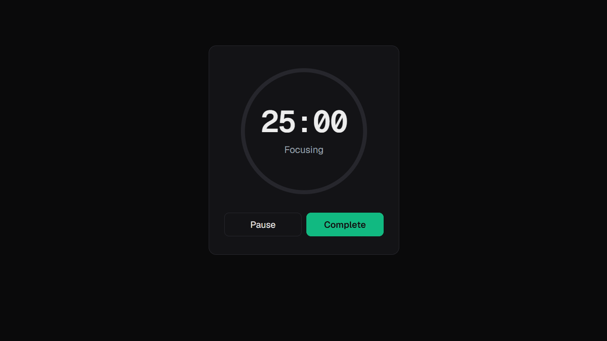

# track-pro

A minimal focus timer that turns every finished session into a square on your year, like a contribution graph for deep work.

<p align="center">
  
</p>

**Live:** https://track-pro-sage.vercel.app

## Features

**Timer**
- Focus sessions from 1 minute to 12 hours, with pause, resume and overtime
- A progress ring around the clock (or a wall clock), and a full screen focus mode
- A bell when you reach your target; your background sound keeps playing into overtime
- Sessions survive refresh, tab close and a second device
- Keeps working when your connection drops: pause, resume and complete are saved in the browser and synced when you are back

**Sound**
- Background sounds generated in the browser: white, pink and brown noise, rain and waves
- Or your own music: save up to 5 YouTube or Spotify links and they play and pause with your session

**History**
- Week, month and year views in your own timezone, with total, daily average, sessions and the change from the previous period
- Browse back to your very first session
- Every past session in a list under the chart: edit notes, add a screenshot, or delete it

**Everything else**
- Sign in with Google or GitHub
- Five themes (system, light, dark, matrix, cyberpunk), saved to your account
- Works on phones, tablets and desktops

## Stack

Next.js (App Router, server actions) · Clerk · Neon Postgres + Drizzle · Vercel Blob · Tailwind CSS · Recharts · Web Audio · Vitest + Playwright

## Run locally

```bash
pnpm install
cp .env.example .env.local   # fill in Clerk, Neon and Blob values
pnpm exec drizzle-kit push   # create the tables
pnpm dev
```

## Tests

```bash
pnpm test       # unit + integration (needs TEST_DATABASE_URL, a separate Neon branch)
pnpm test:e2e   # Playwright smoke tests (needs E2E_CLERK_USER_EMAIL)
```
